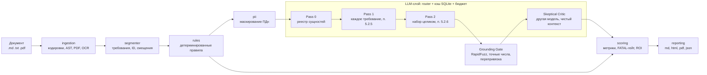

# req-validator — агент статической проверки требований

CLI-агент для ревью документа требований (SRS/BRD) до начала разработки. Агент выделяет отдельные требования, проверяет каждое и весь набор по критериям **ISO/IEC/IEEE 29148:2018 (п. 5.2.5, 5.2.6)** и **IEEE Std 830-1998 (п. 4.3)** и записывает отчёт на русском языке (Markdown / HTML / PDF / JSON).

Хакатон BCC-HUB x MNU FinTech. Бюджет — **$0**: только бесплатные API (Google AI Studio, OpenRouter free, при наличии — Groq и NVIDIA NIM) и локальный Ollama.

**Главный принцип:** LLM ищет смысловые дефекты, а всё проверяемое делает детерминированный код. Каждое замечание в отчёте привязано к дословной цитате документа и к конкретному требованию. Каждую находку LLM уровня FATAL/MAJOR дополнительно проверяет независимый Критик. Метрики, вердикт и ROI считаются формулами, без LLM.

## Быстрый старт

```bash
uv sync
```

Если `uv` не установлен, подойдёт обычный `pip` (Python ≥ 3.12). Команды выполняются из корня репозитория:

```bash
python3 -m venv .venv && source .venv/bin/activate && pip install -e .
```

После этого вместо `uv run req-validator …` используйте `req-validator …`. PDF собирается встроенным Python-пакетом [`typst`](https://pypi.org/project/typst/): системный бинарник Typst, LaTeX или браузер не нужны.

**Демо без ключей и сети** (только детерминированные правила, вердикт предварительный):

```bash
uv run req-validator analyze path/to/requirements.md --out reports/report.md --format md,pdf,html --demo
```

**Боевой режим.** Нужен хотя бы один бесплатный ключ: [aistudio.google.com](https://aistudio.google.com/) → **Get API key**. Ключ вписывается в `.env`:

```bash
cp .env.example .env
```

```bash
uv run req-validator doctor --online
```

```bash
uv run req-validator analyze path/to/requirements.md --out reports/report.md --format md,pdf,html
```

Отчёты лягут в `reports/report.{md,pdf,html}`. Повторный прогон того же документа берёт неизменившиеся LLM-шаги из `.cache/agent_checkpoints.db` и не тратит квоты.

### Проверка устойчивости на плохих входах

Агент никогда не падает с трейсбеком. На плохом входе он пишет отчёт с диагностикой и вердиктом `CANNOT_PROCEED`, а LLM при этом не вызывает:

| Вход | Статус чтения | Вердикт |
| :--- | :--- | :--- |
| Пустой `.md` | `EMPTY_DOCUMENT` | `CANNOT_PROCEED` |
| Битый PDF (`tests/fixtures/broken_edge_case.pdf`) | `CORRUPTED_FILE` | `CANNOT_PROCEED` |
| Бинарный мусор с расширением `.md` | `CORRUPTED_FILE` | `CANNOT_PROCEED` |
| Скан PDF без текстового слоя (без OCR) | `NO_TEXT_LAYER` | `CANNOT_PROCEED` |
| `.md` в кодировке cp1251 / koi8-r / utf-16 | `OK` | обычная проверка |

```bash
uv run req-validator analyze tests/fixtures/broken_edge_case.pdf --out reports/broken.md --demo
```

```bash
uv run pytest -q tests/test_ingestion.py
```

## Архитектура



| Модуль | Ответственность |
| :--- | :--- |
| `ingestion.py` | `.md/.txt/.pdf`, автоопределение кодировки, Markdown AST, PDF → Markdown, OCR-fallback, диагностика |
| `segmenter.py` | атомарные требования: путь заголовков, ID документа или `REQ-xxx`, точные смещения |
| `rules.py` | regex-словарь стоп-паттернов (TBD, «и т.д.», «быстро», границы, ID, версия) |
| `pii.py` | маскирование PAN (Luhn), ИИН (контрольная сумма), IBAN, телефонов, e-mail и ключей → псевдонимы |
| `prompts.py` | версионированные промпты (хэш в ключе кэша и паспорте), документ в `<untrusted_document>` |
| `auditor.py` | Pass 0/1/2, проверка цитат с одним ремонтом, Критик, блочные режимы при сбоях |
| `router.py` | группы `deep`/`fast`, backoff + full jitter + Retry-After, cooldown, TPM-гард, переключение моделей при пустом/битом ответе |
| `guards.py` / `cache.py` | бюджет шагов, токенов и времени, детектор повторов, circuit breaker; SQLite-кэш шагов |
| `grounding.py` | проверка цитат, перепривязка к требованию или заголовку раздела, дедупликация, Decimal-калькулятор |
| `scoring.py` | метрики DoR, некомпенсаторный FATAL-гейт, план исправлений, ROI |
| `reporting.py` | Jinja2 → `.md/.html`, Typst → `.pdf` |

### Чем это лучше наивного подхода «отправить документ в LLM»

| Риск | Наивный промпт «найди ошибки в ТЗ» | req-validator |
| :--- | :--- | :--- |
| Выдуманные цитаты и номера пунктов | попадают в отчёт | каждая цитата сверяется с документом (точно или RapidFuzz); подменённые числа отклоняются |
| Пропуск части длинного документа | модель «устаёт» к концу | детерминированная нарезка, батчи по 5 требований, покрытие «67 из 67» видно в паспорте |
| Ложные придирки | не фильтруются | negative examples, независимый Критик (подтверждает / понижает / отклоняет), снятие повторов |
| Невоспроизводимость | каждый запуск даёт новый результат | `temperature=0`, SQLite-кэш шагов, версии и хэши промптов в паспорте |
| Сбой или исчерпанная квота API | прогон падает | каскад моделей, cooldown, переключение при пустом/битом JSON; при полном отказе — отчёт на правилах |
| Утечка ПДн в бесплатный API | документ уходит как есть | маскирование ПДн до отправки, восстановление локально |
| Prompt injection из документа | исполняется | spotlighting `<untrusted_document>` и запрет исполнять инструкции |
| Математика и вердикт | «на глаз» модели | Decimal-формулы DoR, некомпенсаторный FATAL-гейт, прозрачный ROI |

## Отчёт

1. **Паспорт прогона:** документ, SHA-256, дата, модели каждого прохода, версии промптов, версия агента (коммит/тег), вызовы и кэш. Блок **«LLM-аудит»** содержит **воронку качества и отсева галлюцинаций**: кандидаты LLM → подтверждено цитатой (с разбивкой по способу) → отклонено → передано Критику → подтверждено / понижено / отклонено → итог.
2. **Нарезка требований:** «ID в отчёте — ID в документе — раздел — формулировка».
3. **Проверка каждого требования:** матрица из 9 критериев п. 5.2.5; замечания с проверенными цитатами, источником (правила / модель), решением Критика и заметкой о скорректированной привязке.
4. **Проверка набора:** 7 критериев п. 5.2.6 / IEEE 830 п. 4.3; противоречия с двумя цитатами.
5. **Сводка:** числа и критичные дефекты, а также **бизнес-ценность (ROI)** — детерминированный расчёт на `Decimal` с явными коэффициентами.
6. **Итог:** можно ли начинать разработку и тестирование, сработавший гейт, план исправлений (P0 → P1 → P2).

### Метрики, вердикт и ROI

* `DD = (10·FATAL + 3·MAJOR + MINOR) / N`; `S = max(0, 100 − (15·FATAL + 100·MAJOR/N + 20·MINOR/N))`.
* **Некомпенсаторный FATAL-гейт:** хотя бы один подтверждённый FATAL (найденный правилом или подтверждённый Критиком) даёт `REJECTED` при любом индексе. Неподтверждённый FATAL исключает `APPROVED`.
* Иначе `REJECTED` при S < 65, `CONDITIONAL_PASS` при 65 ≤ S < 85, `APPROVED` при S ≥ 85. Если проходы выполнены не полностью, вердикт предварительный и не выше `CONDITIONAL_PASS`.
* **ROI** считается детерминированно на `Decimal` в двух сценариях (консервативный и базовый). `часы = N_треб × мин_ревью / 60 + (16·FATAL + 6·MAJOR + h·MINOR) × доля_пропуска_ручным_ревью − дефекты × мин_разбора / 60`, `деньги = часы × ставка`, плюс линейная экстраполяция на поток ТЗ в месяц. По умолчанию: 1,5–2 мин на требование, ручное ревью пропустило бы 40–50 % дефектов, MINOR — 0–0,25 ч, разбор замечания — 3 мин, ставка 10 000 ₸/ч, 30 ТЗ/мес. Порядок величин стоимости позднего исправления — NIST Planning Report 02-3 и IBM Systems Sciences Institute. Все коэффициенты — допущения, настраиваются через `ROI_*` в `.env` и печатаются в отчёте. Часы в «Сводке» и в блоке ROI берутся из одного расчёта.

### Проверка цитат (Grounding Gate)

* Длинные цитаты: точное → нормализованное (пробелы, кавычки, регистр, разметка) → нечёткое совпадение RapidFuzz (≥ 85). При нечётком совпадении числа должны совпасть точно.
* Короткие цитаты (< 5 символов, например `GET`, `404`): только точное совпадение целым токеном.
* Цитата, дословно найденная в другом требовании, перепривязывается к нему; в отчёте пишется «ID скорректирован: A → B».
* Цитата, дословно равная заголовку раздела (например «200. Successful — Created»), привязывается к первому требованию раздела, тоже с заметкой.
* Нечёткие и неоднозначные совпадения не перепривязываются: модели даётся одна попытка исправить цитату, иначе находка отклоняется.

## Модели и маршрутизация

Модели задаются в `.env` строками `провайдер/точный-slug` через запятую; порядок задаёт приоритет. Провайдеры без ключа пропускаются.

| Группа | Назначение | Цепочка по умолчанию |
| :--- | :--- | :--- |
| `deep` | Pass 0, Pass 2 | `gemini-3.6-flash` → `gemini-3.5-flash` → `nemotron-3.5-super-vl:free` → `openrouter/free` → NVIDIA NIM → `gemini-3.5-flash-lite` → Ollama |
| `fast` | Pass 1, ремонт цитат | `gemini-3.5-flash-lite` → Groq → группа `deep` |
| `critic` | Критик | `nemotron-3.5-super-vl:free` → `nemotron-3-ultra:free` → `gemini-3.5-flash` → `openrouter/free` → `gemini-3.6-flash` → группа `deep` |

Порядок по умолчанию проверен живыми запросами на бесплатных ключах (`doctor --ping`). Первыми идут модели, которые стабильно отвечают валидным JSON; модели с 429, 503, таймаутами и пустыми ответами (`gemini-4-*`, `gemini-3.7/3.8-flash`, `pro`) убраны из начала цепочек. Критик начинается с другого семейства моделей (NVIDIA Nemotron через OpenRouter), чем генераторы (Gemini), и дополнительно избегает модели, которая сгенерировала находку. В отчёте показаны пары «генератор → Критик».

Минимальная конфигурация без Groq и NVIDIA:

```env
GEMINI_API_KEY="..."
OPENROUTER_API_KEY="..."
OLLAMA_BASE_URL="http://localhost:11434"
```

Надёжность роутера:

* Встроенные ретраи SDK отключены (`max_retries=0`), все повторы делает роутер.
* При 429/5xx/таймауте — backoff с full jitter и `Retry-After`; после 2 сбоев подряд модель уходит в cooldown на 30–60 с.
* Пустой ответ (≤ 5 токенов без валидного JSON) сразу переводит запрос на следующую модель. Если повторы валидации JSON на модели исчерпаны, следующая модель начинает с чистого диалога.
* Если весь документ не удаётся обработать, Pass 0 повторяется компактными блоками, а Pass 2 — по разделам с общим реестром сущностей.
* Groq: до отправки проверяется размер входа (< 5 500 токенов) и окно TPM. Режимы JSON понижаются цепочкой `json_schema → json_object → схема в промпте`.
* `AgentBudgetGuard` ограничивает шаги, токены и время и ловит повторы; трасса пишется в `.cache/traces/run_<timestamp>.jsonl` с маскированием ПДн.

### Безопасность данных

Перед отправкой во внешние API номера карт, ИИН/БИН, IBAN, телефоны, e-mail и ключи API заменяются псевдонимами `<<PAN_1>>`. Псевдонимы восстанавливаются локально, до проверки цитат. При наличии `presidio-analyzer` маскируются также имена и адреса. Документ передаётся внутри `<untrusted_document>`, и модели запрещено исполнять инструкции из него.

### Параметры `analyze`

| Параметр | Описание |
| :--- | :--- |
| `INPUT_PATH` | Документ требований: `.md`, `.markdown`, `.txt`, `.pdf` |
| `--out`, `-o` | Путь к отчёту (по умолчанию `report.md`) |
| `--format`, `-f` | `auto`, `md`, `html`, `pdf`, `json`, `both` (md+pdf), `all` или список через запятую |
| `--demo` | Без LLM и сети |
| `--no-cache` | Не использовать SQLite-кэш шагов |
| `--max-steps N` | Лимит логических вызовов LLM на прогон |

Коды выхода: `0` — отчёт записан (в том числе при сбое LLM, тогда с пометкой); `1` — не удалось записать ни один формат; `2` — ошибка параметров или нет ни одного ключа и Ollama недоступен.

## Тесты

```bash
uv run pytest -q
```

Сеть в тестах не используется: LLM подменяется фейковым транспортом. Покрыто:

* инжест: кодировки, битые, пустые и сканированные файлы;
* нарезка и детерминированные правила;
* кэш SQLite;
* проверка цитат: подмена чисел, короткие цитаты, перепривязка, заголовки разделов;
* Критик и FATAL-гейт;
* роутер: TPM-гард, 429, cooldown, переключение моделей при пустом/битом ответе, блочные режимы;
* бюджет и circuit breaker;
* маскирование ПДн и spotlighting;
* ROI и воронка качества;
* рендер всех форматов и CLI.

## Known Limitations

* **Модели бесплатных тарифов нестабильны:** квоты и доступность меняются в течение дня. Каскад, cooldown и переключение моделей это переживают. Если ни одна модель цепочки Критика недоступна, Критик может совпасть с генератором (в отчёте видны пары «генератор → Критик»).
* **Recall на `tests/fixtures/flawed_fintech_srs.md` с реальной моделью не измерялся.** Пайплайн проверен на фейковом транспорте и на реальном документе хакатона.
* **Критик проверяет только находки LLM уровня FATAL/MAJOR**, батчами по 6 (`CRITIC_BATCH_SIZE`). Для полной изоляции поставьте `1`.
* **ROI — оценка на допущениях**: доля дефектов, которые пропустило бы ручное ревью, и стоимость часа задаются в `.env`. Для конкретного банка их нужно откалибровать.
* **Presidio не установлен по умолчанию** (тянет spaCy); без него имена людей не маскируются.
* **Python 3.13 в `.python-version`** (uv не смог скачать 3.12 в среде разработки); поддерживаются версии `>=3.12,<3.14`.
* **OCR — extra `ocr`** (`uv sync --extra ocr`). DOCX/RTF/ODT не поддерживаются (`UNSUPPORTED`).
* **Локальная модель `qwen3.5:9b` требует около 7 ГБ свободной памяти.** На машине с меньшим объёмом Ollama отвечает 500, и роутер пропускает её. Можно взять модель меньше (`OLLAMA_MODEL`).
